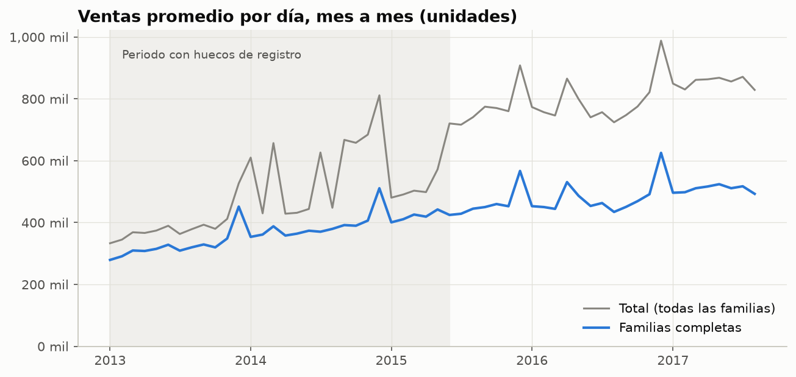
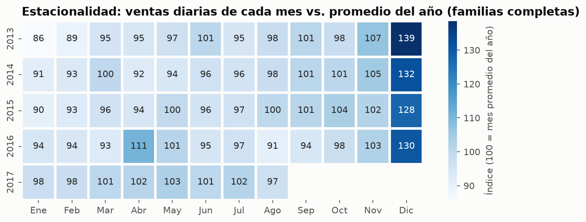
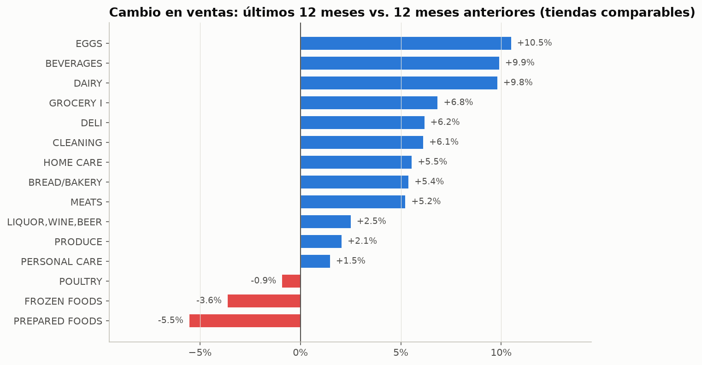
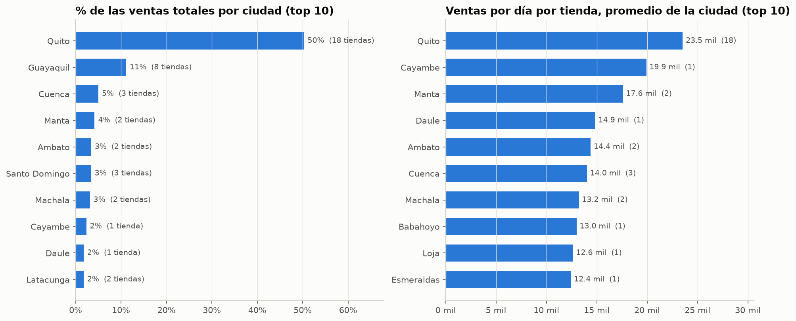
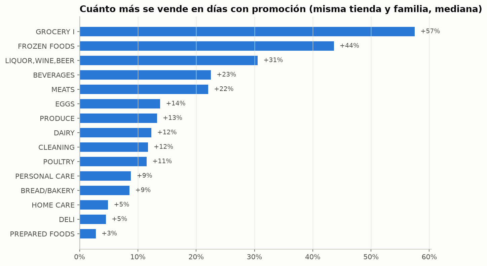
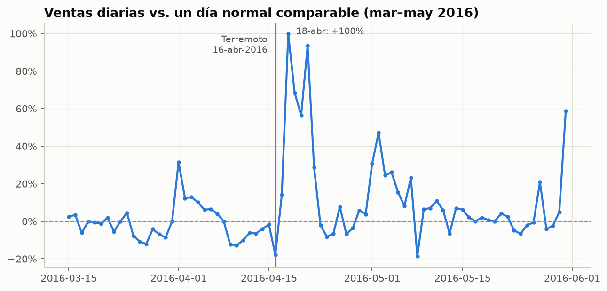

# Análisis de ventas de supermercados en Ecuador 🛒🇪🇨

Análisis exploratorio de **más de 3 millones de registros de ventas diarias** de Corporación Favorita, una de las
cadenas de supermercados más grandes de Ecuador (54 tiendas, 33 familias de productos, enero 2013 – agosto 2017).

**Herramientas:** Python · pandas · matplotlib · seaborn · Jupyter

---

## 📌 Contexto

Una cadena de supermercados necesita entender **qué impulsa sus ventas** para planificar inventario, promociones y
personal. Este proyecto analiza el historial de ventas junto con información de tiendas, promociones, feriados,
precio del petróleo (clave para la economía ecuatoriana) y el terremoto de abril de 2016.

## ❓ Preguntas de negocio

1. ¿Cómo evolucionan las ventas por año y mes? ¿Hay estacionalidad?
2. ¿Qué familias de producto venden más y cuáles crecen o caen?
3. ¿Qué tiendas y ciudades rinden mejor?
4. ¿Las promociones aumentan las ventas?
5. ¿Los feriados, el petróleo y el terremoto de 2016 afectaron las ventas?

## 📥 Cómo descargar los datos

Los datos vienen de la competencia de Kaggle
[Store Sales - Time Series Forecasting](https://www.kaggle.com/competitions/store-sales-time-series-forecasting/data)
y **no se incluyen en el repositorio** (la carpeta `data/` está en `.gitignore`).

**Opción A: desde la web**

1. Inicia sesión en Kaggle, entra a la competencia y acepta las reglas (*Join Competition*).
2. En la pestaña **Data**, descarga los archivos.
3. Copia estos 5 archivos en `data/raw/`: `train.csv`, `stores.csv`, `oil.csv`, `holidays_events.csv`,
   `transactions.csv`.

**Opción B: con la API de Kaggle** (requiere configurar tu token en `~/.kaggle/kaggle.json`)

```bash
pip install kaggle
kaggle competitions download -c store-sales-time-series-forecasting -p data/raw
cd data/raw && unzip store-sales-time-series-forecasting.zip
```

## 🗂️ Estructura del proyecto

```
├── data/
│   ├── raw/          # CSV originales de Kaggle (no se suben a GitHub)
│   └── processed/    # Tablas limpias generadas por el notebook 01
├── notebooks/
│   ├── 01_exploracion_y_limpieza.ipynb   # Calidad de datos, feriados, tablas procesadas
│   └── 02_preguntas_de_negocio.ipynb     # Respuesta a las 5 preguntas, paso a paso
├── sql/              # Consultas SQL (próximo paso del proyecto)
├── images/           # Gráficos exportados por los notebooks
├── reports/          # Resumen ejecutivo de hallazgos
├── requirements.txt
└── README.md
```

## 🔬 Metodología

1. **Exploración y control de calidad** (`01_exploracion_y_limpieza.ipynb`)
   - Revisión de nulos, rangos de fechas y valores atípicos. Faltan solo los 25 de diciembre (tiendas cerradas).
   - Detección de **8 tiendas que abrieron después de 2013** → las tiendas se comparan por *ventas promedio por día*.
   - **Huecos de registro:** hasta mayo de 2015, 12 familias (entre ellas `PRODUCE`, `BEVERAGES` y `HOME CARE`)
     no se registran en muchos meses. Por eso:
     - las tendencias 2013–2017 usan solo las **20 familias completas**;
     - los rankings, el crecimiento por familia y las promociones usan el **periodo confiable (desde jun-2015)**.
   - **Feriados:** se aplicaron las reglas de Kaggle. Un feriado con `transferred = True` se trata como **día
     normal**, y el día marcado como `Transfer` es el **feriado real**. `Bridge` cuenta como feriado y `Work Day`
     como día laborable. Los feriados regionales y locales se cruzan con la provincia o la ciudad de cada tienda.
   - **Petróleo:** los días sin cotización (fines de semana y feriados) se rellenan con el último precio conocido.
2. **Análisis** (`02_preguntas_de_negocio.ipynb`)
   - Comparaciones justas: mismo periodo del año, tiendas comparables y la misma tienda y familia.
   - **Efecto de los feriados:** cada día se compara con la mediana de los días normales del mismo día de la semana,
     mes y año.
   - **Petróleo:** se correlacionan los *cambios* y no los niveles, para evitar correlaciones espurias.

## 📊 Hallazgos principales

### 1. Crecimiento sostenido, pero cada vez más lento, con estacionalidad marcada
Con datos comparables, las ventas crecen todos los años: **+20% (2014) → +15% → +11% → +9% (2017)**.
Diciembre vende ~30% más que un mes promedio, y los fines de semana y los días de pago (inicio y fin de mes)
son los de mayor venta.




### 2. Tres familias concentran dos tercios de las ventas
`GROCERY I` (29%), `BEVERAGES` (22%) y `PRODUCE` (15%) suman el 67% de las ventas. En el último año, en tiendas
comparables, las ventas crecieron un **+6,3%**. Las familias que más crecen son `EGGS`, `BEVERAGES` y `DAIRY`
(~+10%), mientras que `PREPARED FOODS` (−5,5%) y `FROZEN FOODS` (−3,6%) caen.



### 3. Quito concentra la mitad del negocio
Con un tercio de las tiendas, **Quito genera el 50% de las ventas**, y las 7 tiendas que más venden están allí.
Las tiendas **tipo A venden ~4 veces más** que las tipo C. Las tiendas de Guayaquil venden por día la mitad que
las de Quito.



### 4. Las promociones se asocian a ~24% más ventas
Comparando la misma tienda y la misma familia, los días con promoción venden un 24% más (mediana), y esto ocurre en
el 91% de los casos. El efecto es mayor en `GROCERY I` (+57%) y `FROZEN FOODS` (+44%), y casi nulo en
`PREPARED FOODS` y `DELI`.



### 5. Feriados con efectos mixtos, sin efecto visible del petróleo y un pico breve tras el terremoto
- **Navidad +35%** y **1 de enero −22%**. Muchos feriados (Carnaval, Mundial 2014, Viernes Santo) casi no
  cambian las ventas.
- **Petróleo:** la correlación de −0,79 desaparece (+0,04) al analizar los cambios mes a mes: es **espuria**.
- **Terremoto (16-abr-2016):** el 18 de abril se vendió **el doble** que un día normal (compras de primera
  necesidad para donaciones). En una semana las ventas volvieron a la normalidad.



## ✅ Conclusiones y recomendaciones

- **Planificar inventario y personal según el calendario:** reforzar en diciembre, los fines de semana y los días
  de pago (del 30 al 5 de cada mes). La demanda es menor en enero y febrero, los jueves, y entre los días 8–14 y
  25–28 de cada mes.
- **Enfocar las promociones donde funcionan:** `GROCERY I`, `FROZEN FOODS` y bebidas responden bien. En
  `PREPARED FOODS`, `DELI` y `HOME CARE` el efecto es mínimo, así que conviene revisar su rentabilidad.
- **Revisar las categorías en caída:** `PREPARED FOODS` y `FROZEN FOODS` bajan aunque el total crece.
- **Oportunidad fuera de Quito:** las tiendas de Guayaquil rinden la mitad que las de Quito. Entender por qué
  (formato, ubicación, competencia) puede mostrar dónde crecer.
- **Preparar un protocolo para emergencias:** el terremoto mostró que la demanda de primera necesidad puede
  duplicarse en pocos días.
- **Calidad de datos:** los huecos de registro anteriores a junio de 2015 deben resolverse (o excluirse) antes de
  construir cualquier modelo de predicción.

## ⚠️ Limitaciones

- `sales` está en **unidades**, no en dólares: no se puede analizar ingresos ni márgenes.
- El análisis de promociones es **observacional**: muestra asociación, no causalidad. Las promociones podrían
  coincidir con días de alta demanda.
- Cada feriado aparece pocas veces (de 3 a 10), así que sus efectos son orientativos.
- El significado de los tipos de tienda (A–E) y de los clusters no está documentado por Kaggle.

## ▶️ Cómo ejecutar el proyecto

Requisitos: Python 3.10 o superior.

```bash
# 1. Clonar el repositorio
git clone <url-del-repositorio>
cd analisis-ventas-supermercado-ecuador

# 2. Crear y activar un entorno virtual
python -m venv .venv
.venv\Scripts\activate          # Windows
# source .venv/bin/activate     # macOS / Linux

# 3. Instalar dependencias
pip install -r requirements.txt

# 4. Descargar los datos en data/raw/ (ver sección "Cómo descargar los datos")

# 5. Abrir Jupyter y ejecutar los notebooks en orden: 01 y luego 02
jupyter lab
```

El notebook `01` genera los archivos de `data/processed/` que usa el notebook `02`.

## 🚀 Próximos pasos

- Replicar las consultas principales en **SQL** (carpeta `sql/`).
- Construir un **dashboard** (Power BI / Tableau / Looker Studio) con los indicadores clave.
- Entrenar un **modelo de predicción** de ventas usando los feriados por tienda ya preparados.
